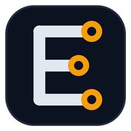

<h2 align="center">Merhaba, ben ERCO 👋</h2>

<b>Güç elektroniği · Gömülü sistemler · IoT · Yerel yapay zekâ</b> 
Donanımı, firmware'i ve yazılımı birlikte tasarlıyorum: karttan buluta, sensörden yapay zekâya.

  
  
  
  
  
  
  
  
  

### 🔧 Neler yapıyorum

- ⚡ **Endüstriyel güç elektroniği:** Tristörlü redresörler için faz açısı kontrollü tetikleme ve kontrol kartları
  (ATmega2560 bare-metal C, sıfır geçiş algılama, CV/CC kontrol, korumalar, Modbus RTU/TCP, ESP32 web paneli).
- 🤖 **Robotik:** Telefonu yerel yapay zekâ beyni, ESP32'yi güvenlik otoritesi olarak kullanan internetsiz robotlar.
- 🧠 **Yerel yapay zekâ:** İnternetsiz, kaynak gösteren Türkçe bilgi asistanı ve sesli asistan; Arduino'yu
  doğal dille yöneten araçlar.
- 🖨️ **3B tasarım:** Python ve OpenSCAD ile parametrik, baskıya hazır modeller.

### 🌱 Öğrendiklerim ve ilgi alanlarım

IoT, gömülü sistem mühendisliği, PCB tasarımı, endüstriyel haberleşme (RS485 / RS232 / Modbus),
cihaz üzerinde çalışan yapay zekâ modelleri.

### 🤝 İş birliği

Gömülü sistem, IoT, güç elektroniği ve donanım–yazılım projelerinde birlikte çalışmaya açığım.

### 📫 İletişim

[vatankuluercan@gmail.com](mailto:vatankuluercan@gmail.com)

🇬🇧 English

**Hi, I'm ERCO.** I design hardware, firmware and software together: power electronics (thyristor rectifier
control boards with ATmega2560 and ESP32), embedded systems and IoT, robots with on-device AI, and offline
Turkish AI assistants. Currently learning more about IoT and embedded engineering, and open to collaboration on
embedded, IoT, power electronics and hardware–software projects. Reach me at
[vatankuluercan@gmail.com](mailto:vatankuluercan@gmail.com).

